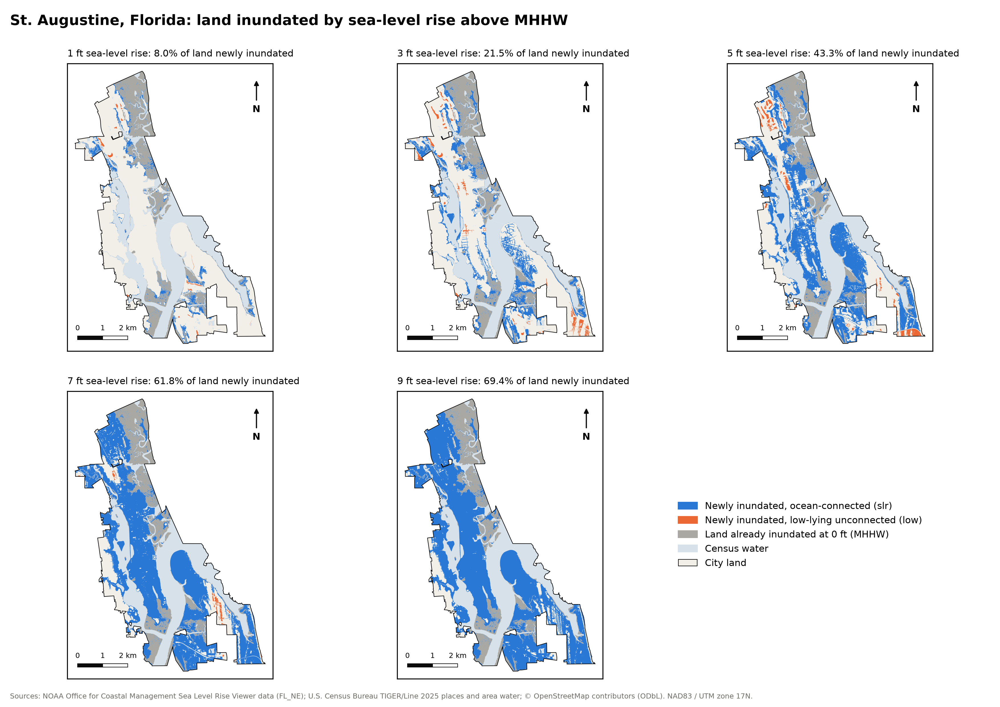
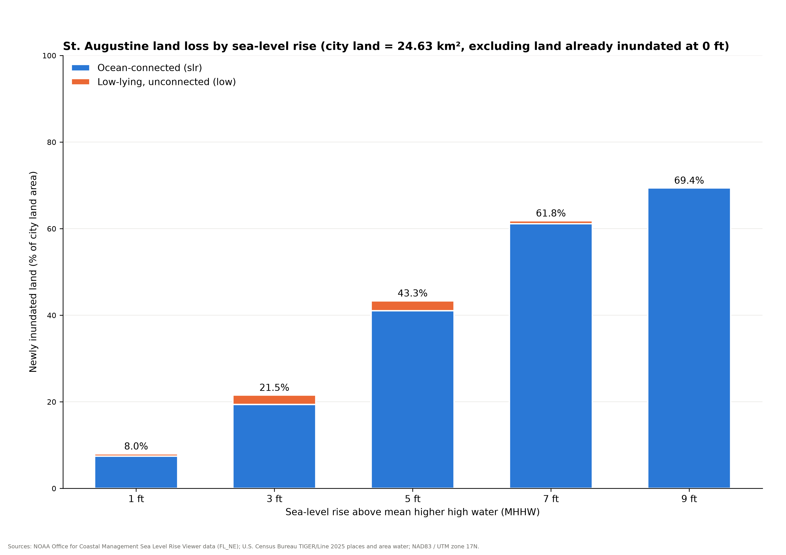
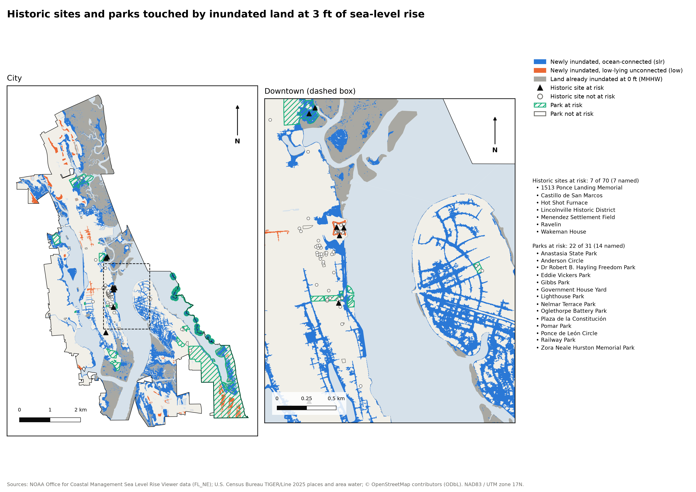

# St. Augustine sea-level-rise scenarios

A small, reproducible pipeline that rebuilds a sea-level-rise study of
St. Augustine, Florida from public data. For each scenario level (1, 3, 5, 7
and 9 ft above today's high tide) it reports:

- how much of the city's land is inundated, with ocean-connected flooding
  (`slr`) and unconnected low-lying areas (`low`) kept apart,
- how much of that land was already inundated at 0 ft and how much is new,
- which OpenStreetMap historic sites and parks touch the inundated land.

One command reruns everything, the run checks its own results, and it writes
a manifest that records exactly which data and code produced the outputs.

**Project page:** <https://lunarc-seattle.github.io/st-augustine-slr/>, with
the results and every figure as a zoomable vector PDF.

## Results

City land is 24.63 km². At 0 ft (today's MHHW) 5.68 km² of it, mostly tidal
marsh, is already inundated. On top of that, new inundation is:

| Sea-level rise | New inundation | Share of city land |
|---|---|---|
| 1 ft | 1.97 km² | 8.0% |
| 3 ft | 5.30 km² | 21.5% |
| 5 ft | 10.67 km² | 43.3% |
| 7 ft | 15.22 km² | 61.8% |
| 9 ft | 17.09 km² | 69.4% |

At 3 ft, 7 of 70 OSM historic sites (including the Castillo de San Marcos and
the Lincolnville Historic District) and 22 of 31 parks (including the Plaza de
la Constitución) touch inundated land.







The PNGs in `docs/figures/` and the PDFs in `docs/pdf/` are copies of the
figures that `make run` writes to `outputs/`. `docs/` is also the project page,
served by GitHub Pages. Copy the figures again after a change that moves the
results.

## Quick start

```bash
make data   # create .venv, download sources into data/cache (once)
make run    # analysis, self-checks, CSVs, figures and manifest -> outputs/
make test   # offline tests on a small fixture (about 1 s)
```

To add or remove a scenario level, edit `levels_ft` in `scenarios.yaml`. No
code change is needed: NOAA publishes layers in half-foot steps from 0 to 10 ft.

## Outputs

| File | Content |
|---|---|
| `outputs/land_loss.csv` | One row per level and kind (`slr`, `low`, `total`): city land, inundated land, part already inundated at 0 ft, new inundation, new inundation as % of city land |
| `outputs/sites_at_risk.csv` | Every historic site or park touched by inundated land, per level and kind |
| `outputs/fig1_inundation_small_multiples.{png,pdf}` | One map per level, same extent and scale |
| `outputs/fig2_land_loss_by_level.{png,pdf}` | New land loss by level, `slr` and `low` stacked |
| `outputs/fig3_sites_at_risk_3ft.{png,pdf}` | Sites and parks at risk at 3 ft, with a downtown zoom |
| `outputs/manifest.json` | Config, data URLs, SHA-256 and download date of every input, the OSM query and its time, SHA-256 of every output, Python, GDAL and package versions, git commit |

Figures are A4 landscape, as 300-dpi PNG and vector PDF. Reruns produce
byte-identical CSVs and figures, so the output hashes in two manifests can be
compared directly.

## Data sources

| Source | File | Downloaded (UTC) |
|---|---|---|
| NOAA Office for Coastal Management, Sea Level Rise Viewer, inundation vectors for FL_NE (Clay, Duval, Nassau, St. Johns) | [`FL_NE_slr_data_dist.zip`](https://chs.coast.noaa.gov/htdata/Inundation/SLR/BulkDownload/Sea_Level_Rise_Vectors/FL/FL_NE_slr_data_dist.zip) (290 MB) | 2026-10-26 |
| U.S. Census Bureau, TIGER/Line 2025 places, Florida | [`tl_2025_12_place.zip`](https://www2.census.gov/geo/tiger/TIGER2025/PLACE/tl_2025_12_place.zip) | 2026-10-26 |
| U.S. Census Bureau, TIGER/Line 2025 area water, St. Johns County | [`tl_2025_12109_areawater.zip`](https://www2.census.gov/geo/tiger/TIGER2025/AREAWATER/tl_2025_12109_areawater.zip) | 2026-10-26 |
| OpenStreetMap contributors (ODbL), via OSMnx and the Overpass API (`overpass-api.de`), tags `historic=*` and `leisure=park` | frozen in `data/cache/osm/osm_sites.geojson` | queried 2026-10-26 |

Exact timestamps and SHA-256 hashes are in each file's `*.meta.json` in
`data/cache/` and are copied into `outputs/manifest.json` on every run.

## Method

1. **Study area.** The City of St. Augustine (`NAME = "St. Augustine"`,
   `STATEFP = 12`) from TIGER/Line places. All geometry is projected to
   EPSG:26917 (NAD83 / UTM zone 17N), so every area is in square metres.
2. **City land = city boundary minus Census water.** NOAA's inundation
   polygons start at today's mean higher high water (MHHW) and cover the
   rivers, bays and tidal creeks that are already water. Inside the city the
   0 ft `slr` layer alone covers more area than Census counts as water. Without
   removing water, open water would be counted as "land lost". The land
   polygon computed this way agrees with the Census `ALAND` attribute to
   within about 0.14% (24.63 vs. 24.66 km²).
3. **Inundation.** For each level, the `slr` and `low` layers are read
   straight out of the zipped geopackage with a bounding-box filter (no 1.1 GB
   extraction), clipped to the city, dissolved so overlaps are never counted
   twice, and intersected with city land.
4. **Baseline split.** Land inundated at 0 ft (both kinds together) is
   "already inundated today", mostly tidal marsh below MHHW. For each level
   the table reports the total inundated land, the part that was already
   inundated at 0 ft, and the **new** inundation (a geometric difference). The
   figures and the headline "land loss" use new inundation as a share of city
   land.
5. **Sites.** OSM features are clipped to the city boundary, like every other
   layer. A site or park is "at risk" when any part of it touches inundated
   land at that level.
6. **Self-checks (run on every `make run`, and in the tests).**
   - New inundation at 0 ft is exactly 0.
   - New inundation for `slr`, and for `slr` + `low` together, never shrinks
     as the level rises.
   - `slr` and `low` never overlap, which is why `total` can be a plain sum.

   `low` alone is *not* required to grow. Once rising water connects a
   low-lying area to the ocean, NOAA moves it from `low` to `slr`, so `low`
   rises and then falls (it reaches 0 at 9 ft here).

## Tests

`make test` runs pytest on `tests/fixtures/window.gpkg`, a 1.5 km × 1.5 km
window of the real data over downtown, so no download is needed:

- area of a synthetic 1 km² square, the baseline split on synthetic
  squares, dissolving overlaps, layer naming and the site overlay;
- each self-check accepts good tables and rejects bad ones;
- on the fixture, inundated area never shrinks with level, 0 ft new loss is 0,
  and `slr` + `low` = `total`;
- a regression test against `tests/fixtures/baseline_land_loss.csv`, with a
  tolerance of 1e-6 km² (1 m²): well below the data's few-metre resolution and
  well above floating-point noise.

If a method change is intended to move the results, run `make fixture`,
review the new baseline, and commit both fixture files together. GitHub
Actions (`.github/workflows/test.yml`) runs `make test` on `ubuntu-latest`.

## Project layout

```
scenarios.yaml          levels, CRS, study area, OSM tags, source URLs
src/slr/download.py     cached downloads with SHA-256 and date sidecars
src/slr/load.py         read, bbox-filter, clip, project; land = city - water
src/slr/osm.py          OSMnx query, frozen with its Overpass query text
src/slr/analysis.py     areas, baseline split, site overlay, self-checks
src/slr/pipeline.py     runs all scenarios and writes CSVs
src/slr/figures.py      A4 maps and chart (PNG + PDF)
src/slr/manifest.py     run record
src/slr/cli.py          `python -m slr.cli data|run`
docs/                   project page (index.html), figure PNGs and PDFs
scripts/make_fixture.py rebuilds the test fixture and regression baseline
```

## Limits

- NOAA's data show the **potential scale** of inundation for a given rise
  above MHHW, not exact locations or timing. They are a "bathtub" model on a
  lidar DEM: no storm surge, waves, erosion, sediment, drainage or future
  defences. Small features (seawalls, culverts) may be wrong at parcel scale.
- `low` areas are places that would sit below the water level but are not
  connected to the ocean on the DEM. Whether they actually flood depends on
  drainage and groundwater.
- The Census water layer and the NOAA DEM were made at different times and
  scales. Narrow shoreline slivers can fall on the "wrong" side of the line.
- **OSM coverage of historic sites is incomplete** and uneven. Many
  buildings in the historic district are not tagged `historic=*`, so the site
  counts are a lower bound. The OSM extract is frozen at the query time shown
  in the manifest. A fresh query (delete `data/cache/osm/`) may return
  different features.
- "At risk" means any part of the feature touches inundated land, not that
  the feature is damaged or fully flooded.
- The north arrow shows grid north of UTM zone 17N, which differs from true
  north by less than 0.2° at St. Augustine.
- The current city boundary (TIGER 2025) may differ from the one used in the
  original portfolio study, so the numbers are not directly comparable to it.

## Future work

- Add NOAA HURDAT2 to count historical hurricanes that passed near
  St. Augustine.
