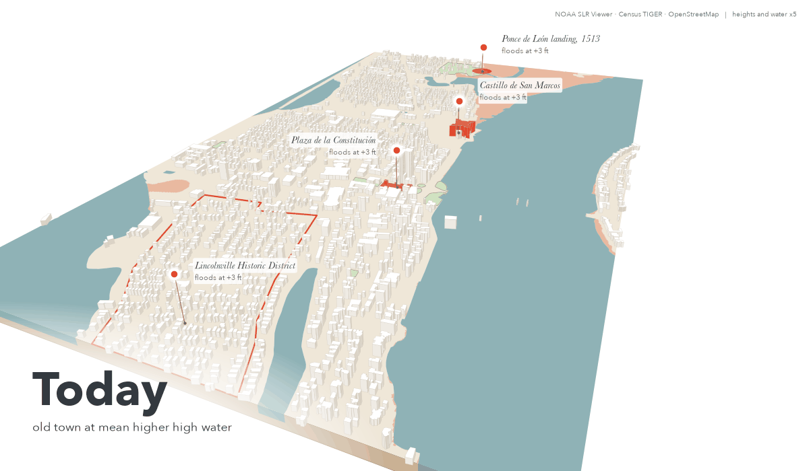
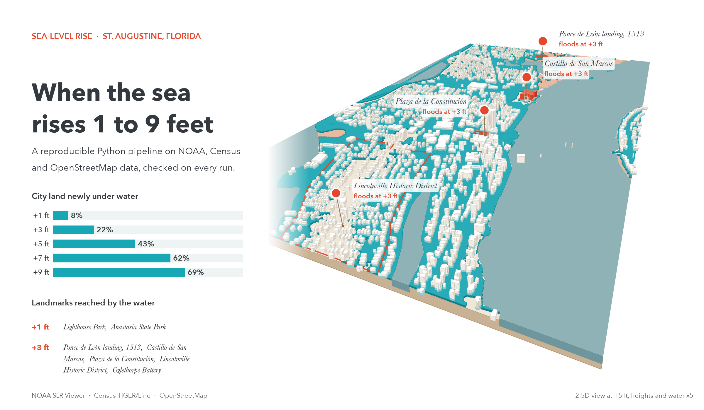
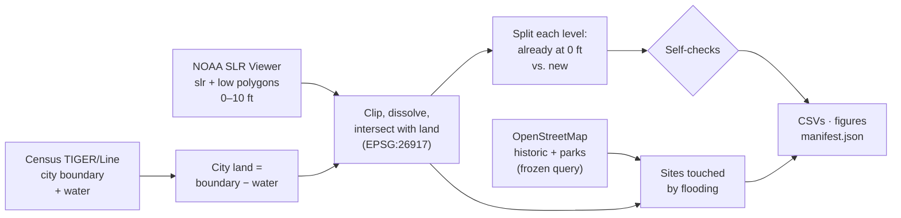
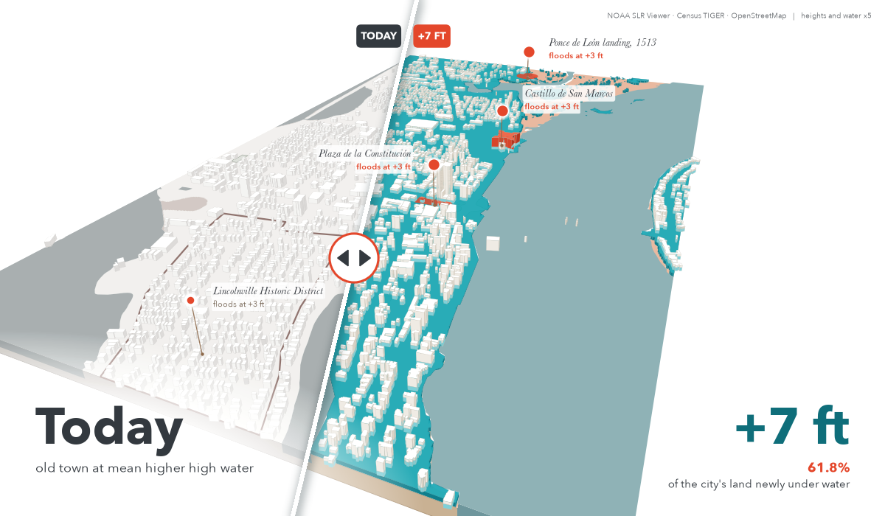
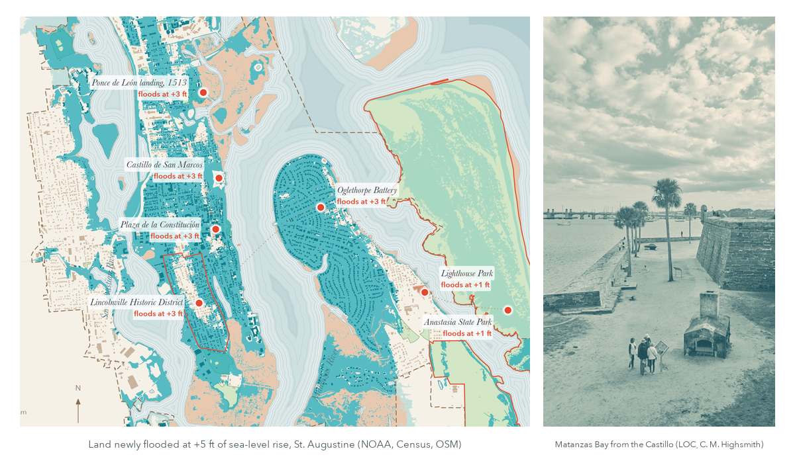

<a href="https://lunarc-seattle.github.io/st-augustine-slr/"></a>

# St. Augustine sea-level-rise scenarios

**How much of St. Augustine, Florida, the oldest continuously inhabited
European-founded city in the continental U.S., goes under water at 1 to 9 ft of sea-level rise, and which historic
sites and parks are in the way?** This is a reproducible Python pipeline built
on NOAA, Census and OpenStreetMap data. One command reruns it, and every run
checks its own results.

[](https://github.com/Lunarc-Seattle/st-augustine-slr/actions/workflows/test.yml)

[](LICENSE)
[](https://lunarc-seattle.github.io/st-augustine-slr/)



> Years ago I studied sea-level rise in St. Augustine for my landscape
> architecture portfolio. The maps were drawn by hand, and the numbers could
> not be checked or rerun. This project rebuilds that analysis from public
> data, as code that anyone can rerun and that tests its own results.

## Key findings

City land is 24.63 km² (city boundary minus Census water). 5.68 km² of it,
mostly tidal marsh, is already inundated at today's high tide (0 ft above
MHHW). On top of that, rising seas newly inundate:

| Sea-level rise | Ocean-connected (`slr`) | Low-lying, unconnected (`low`) | **Total new** | Area |
|---|---|---|---|---|
| 1 ft | 7.4% | 0.5% | **8.0%** | 1.97 km² |
| 3 ft | 19.4% | 2.1% | **21.5%** | 5.30 km² |
| 5 ft | 41.0% | 2.3% | **43.3%** | 10.67 km² |
| 7 ft | 61.1% | 0.7% | **61.8%** | 15.22 km² |
| 9 ft | 69.4% | 0.0% | **69.4%** | 17.09 km² |

<sub>Shares of city land, from `outputs/land_loss.csv`. Shares are rounded
separately, so `slr` + `low` can differ from the total by 0.1.</sub>

- **At 3 ft**, inundated land touches 7 of 70 OSM historic sites, including
  the Castillo de San Marcos and the Lincolnville Historic District, and 22 of
  31 parks, including the Plaza de la Constitución.
- **`low` rises, then falls.** As the water climbs, isolated low spots join
  the ocean and NOAA reclassifies them as `slr`. By 9 ft, every low-lying area
  on city land is ocean-connected.

## Engineering at a glance

- **One command, reproducible.** `make run` downloads, analyses, checks and
  plots. Reruns produce byte-identical CSVs and figures.
- **Provenance.** Every run writes a manifest with SHA-256 hashes and dates
  of all inputs and outputs, the OSM query, package versions and git commit.
- **Self-checking.** Invariants (0 ft new loss is 0, loss never shrinks with
  level, `slr` and `low` never overlap) are asserted on every run.
- **Tested in CI.** Offline pytest suite on a 1.5 km fixture of the real data,
  with a regression baseline, runs on every push in about a second.
- **Config-driven.** Scenario levels, CRS, study area and sources live in
  `scenarios.yaml`. Adding a level needs no code change.
- **Memory-aware I/O.** Layers are read straight out of a 290 MB zipped
  geopackage with a bounding-box filter, never extracting the 1.1 GB file.

Stack: Python, GeoPandas, Shapely, pyogrio/GDAL, pyproj, OSMnx, pandas,
Matplotlib, pytest, GitHub Actions, GitHub Pages.

## How it works



> [!NOTE]
> **Why subtract water?** NOAA's polygons start at today's high-tide line, so
> they include rivers and bays that are already water. Inside the city, the
> 0 ft layer alone covers more area than Census counts as water. Counting it
> would report open water as "land lost". After subtracting Census water,
> the land area matches Census `ALAND` to within 0.14%.

## Figures

**Cover graphics.** The animation, the poster and the plan below are
illustrative renders, rebuilt with `make covers` (after `make run`) from
`scripts/covers/`. They use the same NOAA, Census and OSM layers, plus two
inputs frozen in `data/frozen/`: OSM building footprints with their Overpass
query and time, and one public-domain Library of Congress photo by Carol M.
Highsmith. Building heights come from `building:levels` (untagged = one
storey) and are exaggerated, with the water, five times in the 2.5D views.
Percentages and flood levels are read from `outputs/land_loss.csv` and
`outputs/sites_at_risk.csv`.






All figures are A4 landscape, 300-dpi PNG plus vector PDF. On the
[project page](https://lunarc-seattle.github.io/st-augustine-slr/) you can
zoom into the PDFs.

**Five levels, same extent and scale**


<table>
  <tr>
    <td width="50%" valign="top">
      <b>New land loss by level</b><br>
      
    </td>
    <td width="50%" valign="top">
      <b>Historic sites and parks at risk at 3 ft</b><br>
      
    </td>
  </tr>
</table>

## Quick start

```bash
make data   # create .venv, download sources into data/cache (once, ~300 MB)
make run    # analysis, self-checks, CSVs, figures and manifest -> outputs/
make test   # offline tests on a small fixture, with coverage (a few seconds)
make lint   # ruff lint and format check, as in CI
make docs   # copy the figures into docs/ for the README and project page
make covers # cover GIF, poster and plan graphic (scripts/covers/, data/frozen/)
```

The Makefile works on Linux, macOS and Windows (Git Bash with GNU make).
Without make, the same steps are:

```bash
python -m venv .venv            # then activate it
pip install -r requirements.txt && pip install --no-deps -e .
slr data && slr run             # or: python -m slr.cli run --config scenarios.yaml --out outputs
pytest
```

`requirements.txt` pins exact versions for reproducible runs; `pyproject.toml`
declares the supported ranges and the `slr` command.

To add or remove a scenario level, edit `levels_ft` in `scenarios.yaml`. No
code change is needed: NOAA publishes layers in half-foot steps from 0 to 10 ft.

## Method

1. **Study area.** The City of St. Augustine (`NAME = "St. Augustine"`,
   `STATEFP = 12`) from TIGER/Line places. All geometry is projected to
   EPSG:26917 (NAD83 / UTM zone 17N), so every area is in square metres.
2. **City land = city boundary minus Census water.** NOAA's inundation
   polygons start at today's mean higher high water (MHHW) and cover the
   rivers, bays and tidal creeks that are already water. Inside the city the
   0 ft `slr` layer alone covers more area than Census counts as water. Without
   removing water, open water would be counted as "land lost". The land
   polygon computed this way agrees with the Census `ALAND` attribute to
   within about 0.14% (24.63 vs. 24.66 km²).
3. **Inundation.** For each level, the `slr` and `low` layers are read
   straight out of the zipped geopackage with a bounding-box filter (no 1.1 GB
   extraction), clipped to the city, dissolved so overlaps are never counted
   twice, and intersected with city land.
4. **Baseline split.** Land inundated at 0 ft (both kinds together) is
   "already inundated today", mostly tidal marsh below MHHW. For each level
   the table reports the total inundated land, the part that was already
   inundated at 0 ft, and the **new** inundation (a geometric difference). The
   figures and the headline "land loss" use new inundation as a share of city
   land.
5. **Sites.** OSM features are clipped to the city boundary, like every other
   layer. A site or park is "at risk" when any part of it touches inundated
   land at that level.
6. **Self-checks (run on every `make run`, and in the tests).**
   - New inundation at 0 ft is exactly 0.
   - New inundation for `slr`, and for `slr` + `low` together, never shrinks
     as the level rises.
   - `slr` and `low` never overlap, which is why `total` can be a plain sum.

   `low` alone is *not* required to grow. Once rising water connects a
   low-lying area to the ocean, NOAA moves it from `low` to `slr`, so `low`
   rises and then falls (it reaches 0 at 9 ft here).

## Limits

- NOAA's data show the **potential scale** of inundation for a given rise
  above MHHW, not exact locations or timing. They are a "bathtub" model on a
  lidar DEM: no storm surge, waves, erosion, sediment, drainage or future
  defences. Small features (seawalls, culverts) may be wrong at parcel scale.
- This is **not a HAND or hydrodynamic flood model**. HAND (Height Above
  Nearest Drainage) maps riverine flooding from each cell's height above the
  nearest stream. NOAA's sea-level-rise method instead raises the MHHW tidal
  surface (from VDatum) by the scenario amount, compares it with the DEM, and
  splits cells below the water into ocean-connected (`slr`) and unconnected
  (`low`). This pipeline runs no flood model at all: it reads NOAA's
  precomputed polygons and does area and overlay analysis on them.
- `low` areas are places that would sit below the water level but are not
  connected to the ocean on the DEM. Whether they actually flood depends on
  drainage and groundwater.
- The Census water layer and the NOAA DEM were made at different times and
  scales. Narrow shoreline slivers can fall on the "wrong" side of the line.
- **OSM coverage of historic sites is incomplete** and uneven. Many
  buildings in the historic district are not tagged `historic=*`, so the site
  counts are a lower bound. The OSM extract is frozen at the query time shown
  in the manifest. A fresh query (delete `data/cache/osm/`) may return
  different features.
- "At risk" means any part of the feature touches inundated land, not that
  the feature is damaged or fully flooded.
- The north arrow shows grid north of UTM zone 17N, which differs from true
  north by less than 0.2° at St. Augustine.
- The current city boundary (TIGER 2025) may differ from the one used in the
  original portfolio study, so the numbers are not directly comparable to it.

<details>
<summary><b>Outputs</b></summary>

| File | Content |
|---|---|
| `outputs/land_loss.csv` | One row per level and kind (`slr`, `low`, `total`): city land, inundated land, part already inundated at 0 ft, new inundation, new inundation as % of city land |
| `outputs/sites_at_risk.csv` | Every historic site or park touched by inundated land, per level and kind |
| `outputs/fig0_cover.{png,pdf}` | 16:9 overview of the lowest, middle and highest level |
| `outputs/fig1_inundation_small_multiples.{png,pdf}` | One map per level, same extent and scale |
| `outputs/fig2_land_loss_by_level.{png,pdf}` | New land loss by level, `slr` and `low` stacked |
| `outputs/fig3_sites_at_risk_3ft.{png,pdf}` | Sites and parks at risk at 3 ft, with a downtown zoom |
| `outputs/manifest.json` | Config, data URLs, SHA-256 and download date of every input, the OSM query and its time, SHA-256 of every output, Python, GDAL and package versions, git commit |

Reruns produce byte-identical CSVs and figures, so the output hashes in two
manifests can be compared directly. The PNGs in `docs/figures/` and the PDFs
in `docs/pdf/` are copies made by `make docs`. `docs/` is also the project
page, served by GitHub Pages.

</details>

<details>
<summary><b>Data sources</b></summary>

| Source | File | Downloaded (UTC) |
|---|---|---|
| NOAA Office for Coastal Management, Sea Level Rise Viewer, inundation vectors for FL_NE (Clay, Duval, Nassau, St. Johns) | [`FL_NE_slr_data_dist.zip`](https://chs.coast.noaa.gov/htdata/Inundation/SLR/BulkDownload/Sea_Level_Rise_Vectors/FL/FL_NE_slr_data_dist.zip) (290 MB) | 2026-10-26 |
| U.S. Census Bureau, TIGER/Line 2025 places, Florida | [`tl_2025_12_place.zip`](https://www2.census.gov/geo/tiger/TIGER2025/PLACE/tl_2025_12_place.zip) | 2026-10-26 |
| U.S. Census Bureau, TIGER/Line 2025 area water, St. Johns County | [`tl_2025_12109_areawater.zip`](https://www2.census.gov/geo/tiger/TIGER2025/AREAWATER/tl_2025_12109_areawater.zip) | 2026-10-26 |
| OpenStreetMap contributors (ODbL), via OSMnx and the Overpass API (`overpass-api.de`), tags `historic=*` and `leisure=park` | frozen in `data/cache/osm/osm_sites.geojson` | queried 2026-10-26 |

Exact timestamps and SHA-256 hashes are in each file's `*.meta.json` in
`data/cache/` and are copied into `outputs/manifest.json` on every run.

</details>

<details>
<summary><b>Tests</b></summary>

`make test` runs pytest on `tests/fixtures/window.gpkg`, a 1.5 km × 1.5 km
window of the real data over downtown, so no download is needed:

- area of a synthetic 1 km² square, the baseline split on synthetic
  squares, dissolving overlaps, layer naming and the site overlay;
- each self-check accepts good tables and rejects bad ones;
- on the fixture, inundated area never shrinks with level, 0 ft new loss is 0,
  and `slr` + `low` = `total`;
- a regression test against `tests/fixtures/baseline_land_loss.csv`, with a
  tolerance of 1e-6 km² (1 m²): well below the data's few-metre resolution and
  well above floating-point noise.

If a method change is intended to move the results, run `make fixture`,
review the new baseline, and commit both fixture files together.

Other tests cover the download cache (with a fake HTTP response), provenance
sidecars, the manifest, Overpass query capture, the CLI, and a smoke test
that draws every figure on the fixture twice and checks the files are
byte-identical. GitHub Actions (`.github/workflows/test.yml`) runs ruff and
the test suite with coverage on Linux, Windows and macOS.

</details>

<details>
<summary><b>Project layout</b></summary>

```
scenarios.yaml          levels, CRS, study area, OSM tags, source URLs
src/slr/download.py     cached downloads with SHA-256 and date sidecars
src/slr/load.py         read, bbox-filter, clip, project; land = city - water
src/slr/osm.py          OSMnx query, frozen with its Overpass query text
src/slr/analysis.py     areas, baseline split, site overlay, self-checks
src/slr/pipeline.py     runs all scenarios and writes CSVs
src/slr/figures.py      cover, A4 maps and chart (PNG + PDF)
src/slr/manifest.py     run record
src/slr/cli.py          `python -m slr.cli data|run`
docs/                   project page (index.html), figure PNGs and PDFs
scripts/make_fixture.py rebuilds the test fixture and regression baseline
```

</details>

## Future work

- Add NOAA HURDAT2 to count historical hurricanes that passed near
  St. Augustine.

## License

Code is under the [MIT License](LICENSE). The data are not covered by it:
NOAA and U.S. Census data are U.S. Government works in the public domain, and
OpenStreetMap data are © OpenStreetMap contributors under the
[ODbL](https://opendatacommons.org/licenses/odbl/). The figures that show
sites contain OSM data, so reuse of them must credit OpenStreetMap.
